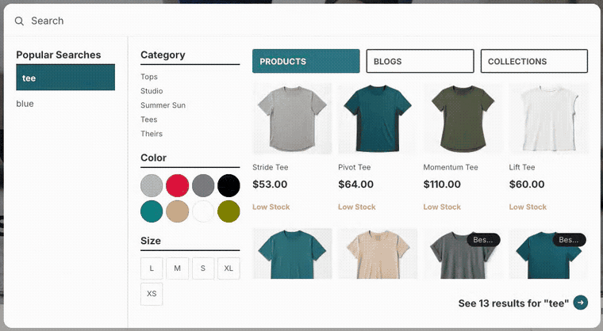

# Autocomplete

>[!IMPORTANT]
> If you have not yet initialized your Snap project, follow the steps in the [Setup guide](https://github.com/athoscommerce/snap/blob/main/docs/SNAP_SETUP.md) before continuing with Feature controllers.

## Autocomplete Controller
To set up Autocomplete using Snap, we'll need to define an autocomplete controller in our Snap configuration. 

>[!TIP]
> See [AutocompleteController reference](https://github.com/athoscommerce/snap/blob/main/packages/snap-controller/src/Autocomplete/README.md) for all available configuration options

When setting up your Autocomplete Controller you'll notice a duplicate **`selector`** property between `config` and `targeters` — each one controls something different:

- **`config.selector`** — the `<input/>` element(s) to attach Autocomplete's events (focus, keydown, submit) to. Supports a selector matching multiple elements.
- **`targeter.selector`** — the element(s) after which Snap injects a container (`.ss__autocomplete--target`) that the `targeter.component` renders into, one per matched element.

In the example below, both use the same selector, so the Autocomplete component renders in a container directly after each `<input/>`.


```js
// src/index.js

import { Snap } from '@athoscommerce/snap-preact';

const snap = new Snap({
	client: {
		globals: {
			siteId: 'REPLACE_WITH_YOUR_SITE_ID',
		},
	},
	controllers: {
		autocomplete: [
			{
				config: {
					id: 'autocomplete',
					selector: 'header input[type="search"]', // <input> to attach Autocomplete's events to
					settings: {
						trending: {
							limit: 5,
						},
						history: {
							limit: 5,
						},
					},
				},
				targeters: [
					{
						selector: 'header input[type="search"]', // element(s) after which Snap injects the `.ss__autocomplete--target` container the component renders into
						hideTarget: true, // hides the matched element until it has been targeted
						component: async () => {
							return (await import('@athoscommerce/snap-preact/components')).Autocomplete;
						},
					},
				],
			},
		],
	},
});
```

---

## Autocomplete Store

The following properties are specific to an Autocomplete Store via an Autocomplete Controller. This section will start with what's unique to Autocomplete, then cover the properties shared with `SearchController`.

>[!NOTE]
> If you are using Snap Components in your integration we recommend utilizing the [Autocomplete](https://athoscommerce.github.io/snap/preact-components?params=?path=/story/organisms-autocomplete--default) component from `@athoscommerce/snap-preact/components` to display Autocomplete.


### AutocompleteController.store.terms

The `terms` property contains an array of autocomplete terms relevant to the query. Each term has a `preview` method, invoked on the `onFocus` event of a term value — this locks the current terms and unlocks the previous facets (if changing terms with a facet filter applied), so the store update for the new term doesn't change the original terms.


>[!TIP]
>For the full breakdown of `Term` object properties, see the [AutocompleteStore reference](https://github.com/athoscommerce/snap/blob/main/packages/snap-store-mobx/src/Autocomplete/README.md#term-object).

```tsx
// src/components/Terms/Terms.jsx

import { h } from 'preact';
import { observer } from 'mobx-react-lite';

export const Terms = observer((props) => {
	const { terms } = props;

	return terms.length !== 0 ? (
		<ul class="ss__terms">
			{terms.map((term) => (
				<li key={term.value} class={`ss__terms__term ${term.active ? 'ss__terms__term--active' : ''}`}>
					<a href={term.url.href} onFocus={term.preview}>
						{term.value}
					</a>
				</li>
			))}
		</ul>
	) : null;
});
```

>[!TIP]
>`trending` and `history` (below) are arrays of this same `Term` shape — `Terms` takes `terms` as a prop, so the same component renders all three, just passed a different store property.

### AutocompleteController.store.trending

The `trending` property contains an array of trending terms — generated from collected reporting data rather than the current query. It's recommended as a starting point shown when the `<input/>` is focused and empty. Must be enabled by setting **`settings.trending.limit`** to a positive number in the AutocompleteController config.



>[!TIP]
>Renders with the same `Terms` component shown above — pass `controller.store.trending` as the `terms` prop.

### AutocompleteController.store.history

The `history` property contains an array of previously searched terms, stored in localStorage. Can be shown in place of, or alongside, trending and suggested terms. Must be enabled by setting **`settings.history.limit`** to a positive number in the AutocompleteController config.


>[!TIP]
>Renders with the same `Terms` component shown above — pass `controller.store.history` as the `terms` prop.

---

The properties below are shared with `SearchController` — see [Search](https://github.com/athoscommerce/snap/blob/main/docs/SNAP_SEARCH.md) for their full descriptions and worked examples.

### AutocompleteController.store.merchandising

Identical to `SearchController.store.merchandising`.

>[!TIP]
>See the [AutocompleteStore reference](https://github.com/athoscommerce/snap/blob/main/packages/snap-store-mobx/src/Autocomplete/README.md#merchandising-property) for the full property breakdown.

### AutocompleteController.store.search

Same shape as `SearchController.store.search`, except that it does not contain a `didYouMean` query and adds a `correctedQuery`.

>[!TIP]
>See the [AutocompleteStore reference](https://github.com/athoscommerce/snap/blob/main/packages/snap-store-mobx/src/Autocomplete/README.md#search-property) for the full property breakdown.

### AutocompleteController.store.facets

Same shape as `SearchController.store.facets`, with one addition: each facet value also has a `preview` method — invoked on `onFocus`, it marks the value as filtered and locks the facets (so they don't change while the shopper previews other values). Unlike `terms.preview`, it does not lock or change the terms.

>[!TIP]
>See the [AutocompleteStore reference](https://github.com/athoscommerce/snap/blob/main/packages/snap-store-mobx/src/Autocomplete/README.md#facets-property) for the full property breakdown.

### AutocompleteController.store.filters

Identical to `SearchController.store.filters`.

>[!TIP]
>See the [AutocompleteStore reference](https://github.com/athoscommerce/snap/blob/main/packages/snap-store-mobx/src/Autocomplete/README.md#filters-property) for the full property breakdown.

### AutocompleteController.store.results

Identical to `SearchController.store.results`.

>[!TIP]
>See the [AutocompleteStore reference](https://github.com/athoscommerce/snap/blob/main/packages/snap-store-mobx/src/Autocomplete/README.md#results-property) for the full property breakdown.

### AutocompleteController.store.pagination

Identical to `SearchController.store.pagination`.

>[!TIP]
>See the [AutocompleteStore reference](https://github.com/athoscommerce/snap/blob/main/packages/snap-store-mobx/src/Autocomplete/README.md#pagination-property) for the full property breakdown.

### AutocompleteController.store.sorting

Identical to `SearchController.store.sorting`.

>[!TIP]
>See the [AutocompleteStore reference](https://github.com/athoscommerce/snap/blob/main/packages/snap-store-mobx/src/Autocomplete/README.md#sorting-property) for the full property breakdown.

## Putting It Together

With `terms`, `trending`, `history`, and `results` each wired in, the root `Autocomplete` component composes them: suggested terms once the shopper is typing, trending/history as a starting point when the input is empty, and a preview of live results underneath.

```tsx
// src/components/Autocomplete/Autocomplete.jsx

import { h } from 'preact';
import { observer } from 'mobx-react-lite';
import { ControllerProvider, withController } from '@athoscommerce/snap-preact/components';
import { Terms } from '../Terms/Terms';
import { Results } from '../Results/Results';

export const Autocomplete = withController(observer((props) => {
	const { controller } = props;
	const { store } = controller;
	const { search, terms, trending, history, results } = store;

	// trending and history are shown before the first autocomplete response, so don't gate on store.loaded alone
	return store.loaded || trending.length || history.length ? (
		<ControllerProvider controller={controller}>
			<div class="ss__autocomplete">
				{search?.query?.string
					? <Terms terms={terms} />
					: <Terms terms={[...trending, ...history]} />}
				{results.length !== 0 && <Results />}
			</div>
		</ControllerProvider>
	) : null;
}));
```

>[!TIP]
>`Results` is the same component from the [Search](https://github.com/athoscommerce/snap/blob/main/docs/SNAP_SEARCH.md#searchcontrollerstoreresults) page — Autocomplete's `results` property is identical, so it renders without changes.

---
## Troubleshooting FAQ

**Q: Trending terms never show up, even with an empty, focused input. Why?**
<br>
**A:** Confirm `settings.trending.limit` is set to a positive number on the AutocompleteController config — trending terms are opt-in and won't populate `store.trending` without it.

**Q: History / "Recent Searches" never shows up. Why?**
<br>
**A:** Confirm `settings.history.limit` is set to a positive number in the config (and `settings.history.enabled` is not `false`), and that a search has actually run at least once in this browser — history is written to localStorage when the search controller runs a query (after its `beforeSearch` middleware passes), not on every keystroke, so a fresh browser with no prior searches will show nothing here. A search controller with `settings.history.max: 0` also clears the stored history.

**Q: Hovering a suggested term doesn't update the results/facets preview. Why?**
<br>
**A:** Confirm `term.preview` is wired to the term's `onFocus` event, as shown in the `Terms` example above — without calling `preview()`, the store has no signal to fetch and lock in that term's results.

